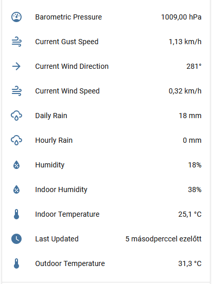

# Wunder2MQTT 

**Wunder2MQTT** is a Home Assistant app that acts as a local HTTP bridge, translating Weather Underground (Wunderground) HTTP requests from weather stations into Home Assistant MQTT.
Free from the cloud! Keep your weather data 100% local.

## Features

* **100% Local:** No internet connection or cloud reliance required. Data goes straight from your station to your Home Assistant.
* **MQTT Auto-Discovery:** Devices and sensors appear automatically in Home Assistant. Zero YAML configuration needed!
* **Pre-configured (but extensible):** The most common weather entities (Outdoor/Indoor Temp & Humidity, Wind, Rain, Barometer) are pre-configured by default. Does your station have extra sensors like soil moisture or solar radiation? You can easily add them via the app UI!
* **Native Unit Conversion:** The app forwards native metrics directly. Home Assistant handles all unit conversions (e.g., °F to °C, mph to km/h) based on your user profile automatically.
* **Smart Timestamps:** Incoming `dateutc` parameters are automatically formatted into standard ISO 8601 UTC timestamps, rendering perfectly in your local timezone.

## Installation

### Option A: One-Click Install

Click the button below to automatically add this repository to your Home Assistant:

1. Scroll down (or refresh), and look for **Wunder2MQTT** in the store.
2. Install, configure and start the app!

### Option B: Manual Install

1. Open Home Assistant and navigate to **Settings** -> **Apps**.
2. Click the **Install app** button in the bottom right.
3. Click the three dots (menu) in the top right corner and select **Repositories**.
4. Paste the URL of this GitHub repository and click **Add**.
5. Close the dialog, scroll down (or refresh), and look for **Wunder2MQTT** in the store.
6. Install, configure and start the app!

*Note: You must have a working MQTT Broker (like the official Mosquitto app) installed and configured in Home Assistant.*

## Configuration

The app comes with **11 basic sensors pre-configured** (Temperature, Humidity, Wind, Rain, Pressure). If your station provides more data, you can easily add new sensors to the list.
Enable **"Log Raw Data"** to see all incoming HTTP keys in the app logs, which makes it incredibly easy to find and map extra sensors!

## Weather Station Setup

To route your weather station's data to this app, use one of the two methods below depending on your device's capabilities:

### Method 1: App Configuration

If your station allows setting up a custom server:

1. Open your weather station's setup app.
2. Select **Customized** / **Custom Server**.
3. **Protocol:** Weather Underground (Wunderground)
4. **Server IP / Hostname:** The local IP of your Home Assistant.
5. **Path:** `/weatherstation/updateweatherstation.php` (or simply `/`)
6. **Port:** `80` (or whatever you mapped in the app settings).

### Method 2: DNS Hijacking (For Hardcoded Stations)

Some weather stations (like the Raddy WF-100C) only ask for Wi-Fi credentials and hardcode the server to `weatherstation.wunderground.com`. To use these locally, you must intercept their traffic:

1. Provide a local Wi-Fi network for the station (e.g., using the *Hass.io Access Point* app with a USB Wi-Fi adapter).
2. Use a DNS server (like the *Dnsmasq* app or your router's DNS settings) to redirect `weatherstation.wunderground.com` to your Home Assistant's local IP address.

## Troubleshooting

* **Sensors aren't showing up?** Check the app logs. Make sure it successfully connected to your MQTT broker.
* **Seeing "Unauthorized" in logs?** If you set a Station ID or Password in the app config, ensure it exactly matches what your weather station console is sending. If in doubt, leave them blank.
